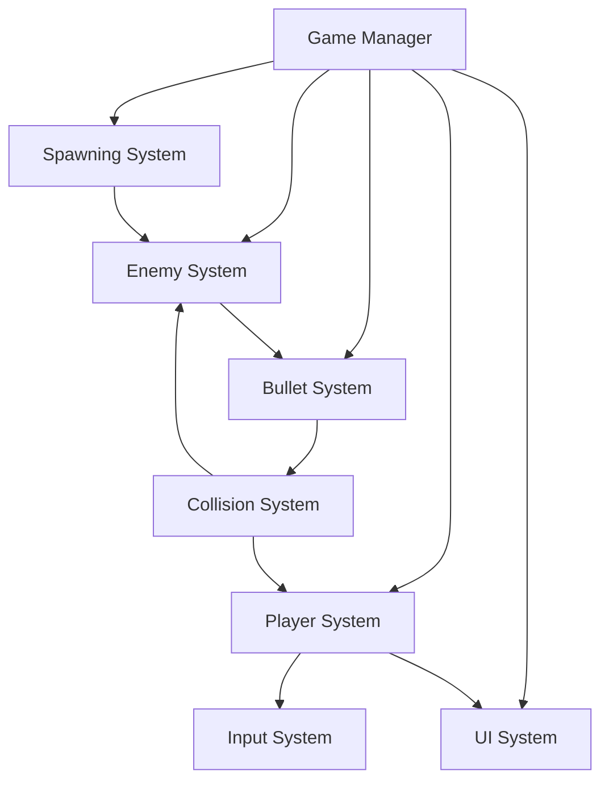
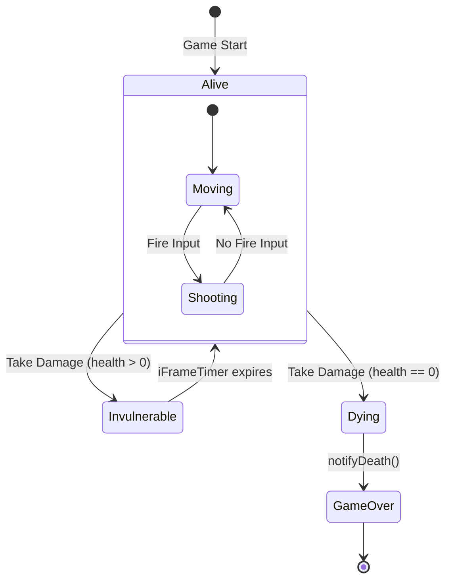
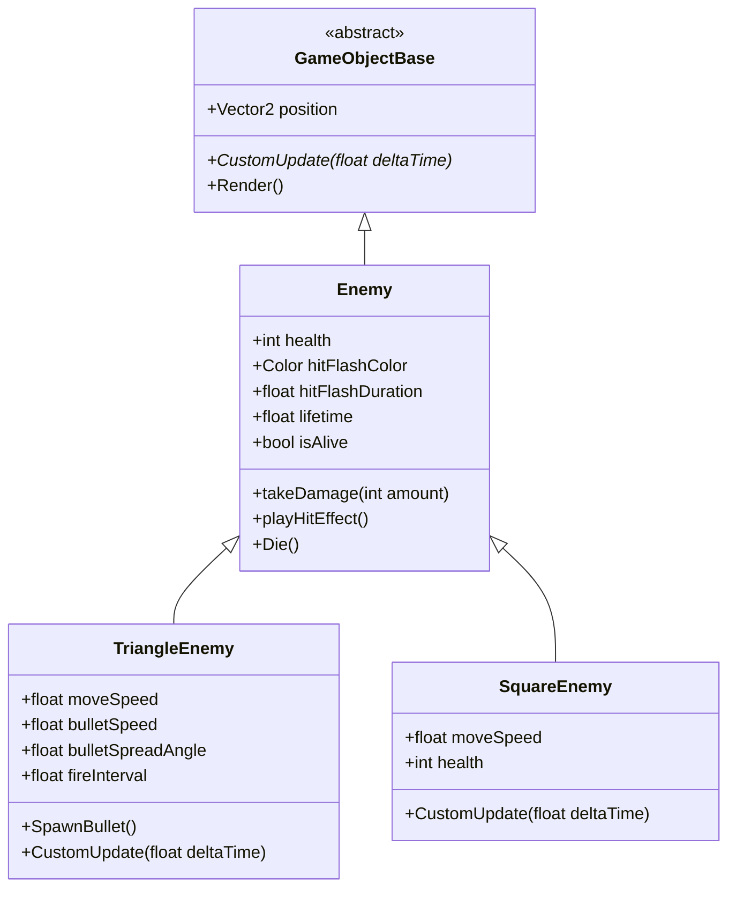
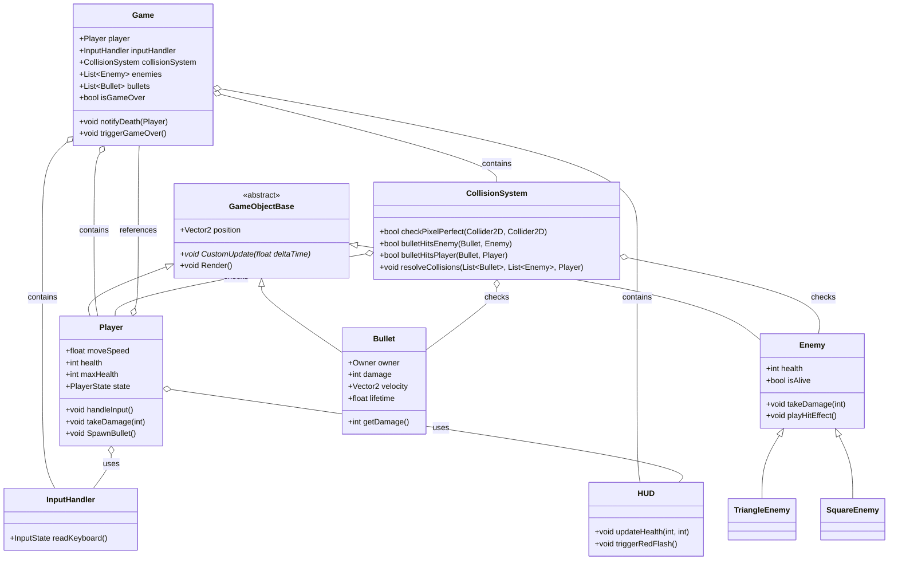
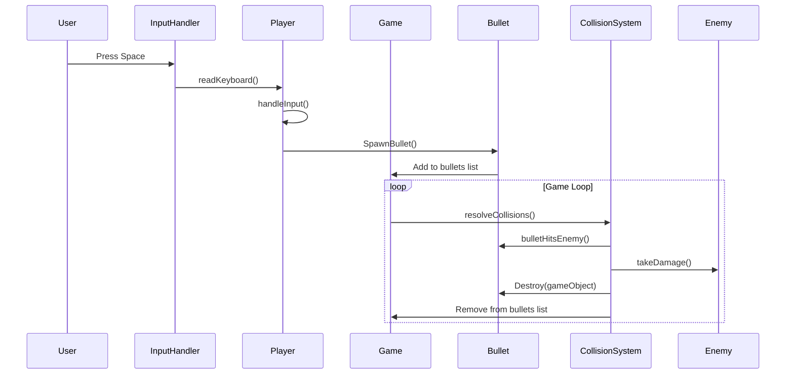
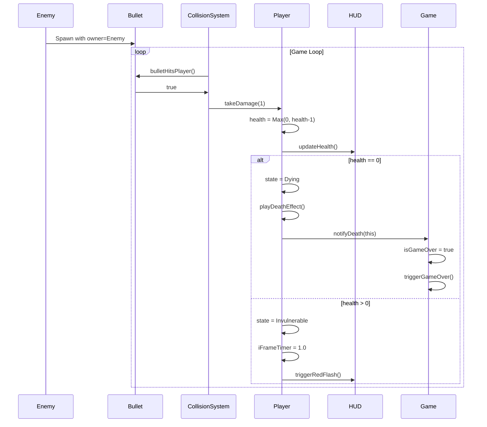
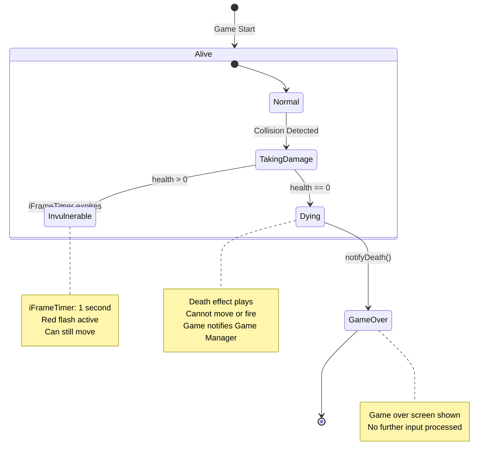
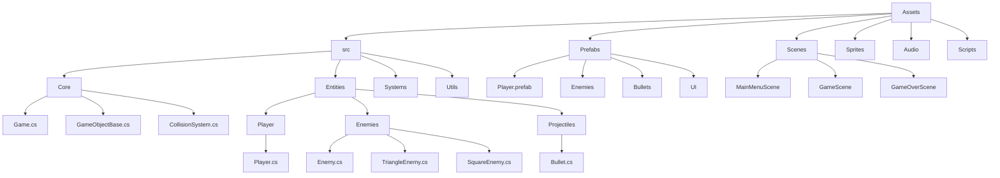

# Technical Design Document: Cosmic Onslaught

**Document Version:** 1.0.0  
**Date:** 2024-12-19  
**Author:** Mistral Vibe (Generated)  
**Project:** CS3650 - Game Design (Cosmic Onslaught)  
**Repository:** https://github.com/rabghannam/CS3650Repo

---

## Table of Contents

1. [Document Overview](#1-document-overview)
2. [Technology Stack](#2-technology-stack)
3. [Coding Conventions & Standards](#3-coding-conventions--standards)
4. [System Architecture](#4-system-architecture)
5. [Core Components & Modules](#5-core-components--modules)
6. [Detailed Component Specifications](#6-detailed-component-specifications)
7. [Design Principles](#7-design-principles)
8. [Design Patterns Applied](#8-design-patterns-applied)
9. [UML Diagrams](#9-uml-diagrams)
10. [Performance Considerations](#10-performance-considerations)
11. [Extensibility & Maintainability](#11-extensibility--maintainability)

---

## 1. Document Overview

### 1.1 Purpose
This Technical Design Document (TDD) provides comprehensive technical specifications for **Cosmic Onslaught**, a 2D bullet hell roguelite game. It defines the technology stack, architectural decisions, coding standards, and detailed specifications for all major game systems.

### 1.2 Scope
- Technology stack and development environment
- Coding conventions and best practices
- High-level system architecture and modular breakdown
- Detailed specifications for 5+ core game components
- Design principles and patterns applied
- UML diagrams for architecture visualization
- Performance and extensibility considerations

### 1.3 Audience
- **Primary:** Game developers on the project
- **Secondary:** Technical reviewers, stakeholders
- **Tertiary:** Future maintainers and contributors

### 1.4 References
| Document | Description | Location |
|-----------|-------------|----------|
| GDD | Game Design Document | `/docs/GDD_CosmicOnslaught.md` |
| MDD | Mechanics Design Document | `/docs/MDD_CosmicOnslaught.md` |

---

## 2. Technology Stack

### 2.1 Development Environment

| Category | Technology | Version | Purpose |
|----------|-------------|---------|---------|
| Game Engine | Unity | 2022.x LTS | Core game framework |
| Language | C# | 8.0+ | Primary programming language |
| IDE | Visual Studio / VS Code | Latest | Code development |
| Version Control | Git | 2.x | Source code management |
| Package Manager | Unity Package Manager | Built-in | Dependency management |

### 2.2 Unity Configuration
```yaml
Engine:
  Scripting Backend: Mono
  API Compatibility: .NET Standard 2.1
  Color Space: Linear
  Physics Engine: Physics2D

Graphics:
  Resolution: 1920x1080 (scalable)
  Target Frame Rate: 60 FPS
  VSync: Off

Physics:
  Gravity: (0, 0)
  Collision Detection: Continuous
```

### 2.3 Tools & Libraries
| Tool | Purpose | Usage |
|------|---------|-------|
| Unity Physics2D | Collision detection | Bullet-enemy interactions |
| Unity UI (uGUI) | User interface | HUD, menus, settings |
| Unity Input System | Modern input handling | Recommended future refactoring |

### 2.4 Technology Justification
- **Unity:** Industry standard with extensive 2D support, asset store, and community
- **C#:** Strong typing, modern features, excellent Unity integration
- **Alternatives Considered:** Godot (lighter), Custom engine (more control)

---

## 3. Coding Conventions & Standards

### 3.1 File Organization Structure
```
Assets/
├── src/
│   ├── Core/                      # Core game systems
│   │   ├── Game.cs                # Game manager
│   │   ├── GameObjectBase.cs      # Base entity class
│   │   └── CollisionSystem.cs     # Collision management
│   │
│   ├── Entities/                  # Game entities
│   │   ├── Player/                # Player system
│   │   │   └── Player.cs          # Main player class
│   │   │
│   │   ├── Enemies/               # Enemy types
│   │   │   ├── Enemy.cs           # Base enemy class
│   │   │   ├── TriangleEnemy.cs   # Specific enemy
│   │   │   └── SquareEnemy.cs     # Specific enemy
│   │   │
│   │   └── Projectiles/           # Bullet system
│   │       └── Bullet.cs          # Bullet class
│   │
│   ├── Systems/                   # Game systems
│   │   ├── Input/
│   │   │   └── InputHandler.cs
│   │   ├── UI/
│   │   │   ├── HUD.cs
│   │   │   └── PauseMenu.cs
│   │   └── Spawning/
│   │       └── EnemySpawner.cs
│   │
│   └── Utils/                     # Utility classes
│       └── Extensions.cs
```

### 3.2 Naming Conventions

**Classes:** PascalCase (`Player`, `Enemy`, `GameManager`, `CollisionSystem`)

**Variables:**
- Public: PascalCase (Unity inspector compatibility)
- Private/Protected: camelCase (C# standard)
- Constants: UPPER_CASE

```csharp
public float moveSpeed = 300f;      // Public
private int _health;                // Private
private const float IFRAME_DURATION = 1f; // Constant
```

**Methods:** PascalCase (`TakeDamage()`, `SpawnEnemy()`, `HandleInput()`)

**Unity-Specific:** Use `[Header]` and `[Tooltip]` attributes liberally

### 3.3 Code Style
- **Indentation:** 4 spaces
- **Braces:** K&R style
- **Line Length:** Max 120 characters
- **XML Documentation:** For public methods
- **Inline Comments:** Explain *why*, not *what*

### 3.4 Error Handling
- Use `Debug.Log()`, `Debug.LogWarning()`, `Debug.LogError()`
- Always validate Unity references
- Avoid exceptions for control flow

---

## 4. System Architecture

### 4.1 High-Level Architecture

The game follows a **Component-Based Architecture** with Unity's GameObject-MonoBehaviour system as the foundation. The architecture is organized into **layers**:

```
┌─────────────────────────────────────────────────────────────┐
│                    PRESENTATION LAYER                         │
│  ┌─────────────┐  ┌─────────────┐  ┌─────────────────────┐ │
│  │   UI/HUD    │  │   Audio     │  │   Rendering         │ │
│  │  (HUD.cs)   │  │ (Future)    │  │  (Unity Renderer)  │ │
│  └─────────────┘  └─────────────┘  └─────────────────────┘ │
└─────────────────────────────────────────────────────────────┘
                         ↑↓
┌─────────────────────────────────────────────────────────────┐
│                    GAME LOGIC LAYER                           │
│  ┌─────────────┐  ┌─────────────┐  ┌─────────────────────┐ │
│  │   Game      │  │  Systems    │  │   Entities          │ │
│  │ (Game.cs)   │↔│(Spawner,    │↔│ (Player, Enemy,     │ │
│  │             │  │ Collision)  │  │  Bullet)            │ │
│  └─────────────┘  └─────────────┘  └─────────────────────┘ │
└─────────────────────────────────────────────────────────────┘
                         ↑↓
┌─────────────────────────────────────────────────────────────┐
│                    DATA & SERVICE LAYER                        │
│  ┌─────────────┐  ┌─────────────┐  ┌─────────────────────┐ │
│  │  Input      │  │  Save/Load  │  │   Configuration     │ │
│  │ (InputHandler)│ │ (Future)    │  │   (ScriptableObjects)│ │
│  └─────────────┘  └─────────────┘  └─────────────────────┘ │
└─────────────────────────────────────────────────────────────┘
                         ↑↓
┌─────────────────────────────────────────────────────────────┐
│                    UNITY ENGINE LAYER                          │
│  ┌─────────────┐  ┌─────────────┐  ┌─────────────────────┐ │
│  │  Physics2D  │  │   Scene     │  │   Object Pooling    │ │
│  │             │  │  Management │  │   (Future)          │ │
│  └─────────────┘  └─────────────┘  └─────────────────────┘ │
└─────────────────────────────────────────────────────────────┘
```

### 4.2 Architectural Patterns

| Pattern | Usage | Benefit |
|---------|-------|---------|
| **Component Pattern** | MonoBehaviour classes | Modularity, reusability |
| **Singleton Pattern** | Game manager access | Global access, single instance |
| **Observer Pattern** | Event notification (death) | Decoupled communication |
| **State Pattern** | Player state machine | Clean state transitions |
| **Template Method** | GameObjectBase.CustomUpdate() | Polymorphic behavior |
| **Object Pool** | Bullet/Enemy management (future) | Performance optimization |

### 4.3 Communication Flow

```
┌──────────┐     ┌──────────┐     ┌──────────┐
│  Input   │────▶│  Player  │────▶│  Bullet  │
│ Handler  │     │          │     │          │
└──────────┘     └────┬─────┘     └────┬─────┘
                        │                │
                        ▼                ▼
                     ┌──────────┐     ┌──────────┐
                     │  Collision│◀────│  Enemy   │
                     │  System  │     │          │
                     └────┬─────┘     └──────────┘
                          │
                          ▼
                     ┌──────────┐
                     │   Game   │
                     │  Manager │
                     └──────────┘
```

### 4.4 Data Flow

```
User Input → InputHandler → Player → (Movement, Shooting)
                      ↓
EnemySpawner → Enemies → Bullet Patterns
                      ↓
CollisionSystem → Damage Application
                      ↓
Game Manager → State Management → UI Updates
```

---

## 5. Core Components & Modules

### 5.1 Component Overview

The game is structured into **8 core modules**, with **5 primary components** selected for detailed specification:

| Module | Component | Type | Dependencies | Status |
|--------|-----------|------|--------------|--------|
| **M01** | Game Manager | Core System | All modules | ✅ Implemented |
| **M02** | Player System | Entity | Input, HUD, Game | ✅ Implemented |
| **M03** | Enemy System | Entity | Game, Bullet | ✅ Implemented |
| **M04** | Bullet System | Entity | Collision, Game | ✅ Implemented |
| **M05** | Collision System | Service | Physics2D | ✅ Implemented |
| **M06** | Input System | Service | Unity Input | ✅ Implemented |
| **M07** | UI System | Service | uGUI | ✅ Implemented |
| **M08** | Spawning System | Service | Game | ✅ Implemented |

### 5.2 Module Relationships



### 5.3 Selected Components for Detailed Specification

The following **5 core components** are selected for detailed technical specification:

1. **C01: Game Manager (Game.cs)** - Central game controller
2. **C02: Player System (Player.cs)** - Player entity and state machine
3. **C03: Collision System (CollisionSystem.cs)** - Centralized collision detection
4. **C04: Enemy System (Enemy.cs + variants)** - Enemy hierarchy and behavior
5. **C05: Bullet System (Bullet.cs)** - Projectile management

---

## 6. Detailed Component Specifications

---

### 6.1 C01: Game Manager

#### 6.1.1 Overview
The **Game Manager** is the central coordinator for the entire game, managing game state, entity lists, and cross-system communication.

#### 6.1.2 Responsibilities
- Maintain global game state (running, paused, game over)
- Track all active entities (players, enemies, bullets)
- Coordinate system updates (collision resolution)
- Handle game lifecycle events (death, game over)
- Manage scene transitions

#### 6.1.3 Technical Specification

**Class:** `Game : MonoBehaviour`

**File:** `/Assets/src/Core/Game.cs`

**Namespace:** Global (default)

**Inheritance:** MonoBehaviour → Game

**Interfaces:** None

#### 6.1.4 Properties

| Property | Type | Access | Description | Default |
|----------|------|--------|-------------|---------|
| `player` | `Player` | Public | Player reference | null |
| `inputHandler` | `InputHandler` | Public | Input system reference | null |
| `collisionSystem` | `CollisionSystem` | Public | Collision system reference | null |
| `hud` | `HUD` | Public | HUD reference | null |
| `gameOverScreen` | `GameOverScreen` | Public | Game over screen reference | null |
| `pauseMenu` | `PauseMenu` | Public | Pause menu reference | null |
| `enemies` | `List<Enemy>` | Public | Active enemy list | new List() |
| `bullets` | `List<Bullet>` | Public | Active bullet list | new List() |
| `isGameOver` | `bool` | Public (get only) | Game over state | false |

#### 6.1.5 Methods

| Method | Signature | Visibility | Description |
|--------|-----------|------------|-------------|
| `Start` | `void Start()` | Private | Initializes game references and state |
| `Update` | `void Update()` | Private | Main game loop - updates entities and resolves collisions |
| `LateUpdate` | `void LateUpdate()` | Private | Cleanup destroyed entities from lists |
| `notifyDeath` | `void notifyDeath(Player p)` | Public | Called when player dies - triggers game over |
| `triggerGameOver` | `void triggerGameOver()` | Public | Handles game over transition |

#### 6.1.6 Unity Callbacks

```csharp
private void Start()
{
    // Initialize references
    player.game = this;
    player.input = inputHandler;
    player.hud = hud;
    hud.updateHealth(player.health, player.maxHealth);
}

private void Update()
{
    if (isGameOver) return;
    if (pauseMenu != null && pauseMenu.IsPaused) return;
    
    collisionSystem.resolveCollisions(bullets, enemies, player);
}

private void LateUpdate()
{
    // Cleanup null references
    enemies.RemoveAll(e => e == null);
    bullets.RemoveAll(b => b == null);
}
```

#### 6.1.7 Dependencies

| Dependency | Type | Purpose |
|------------|------|---------|
| `Player` | Component | Player entity control |
| `InputHandler` | Component | Input processing |
| `CollisionSystem` | Component | Collision detection |
| `HUD` | Component | UI updates |
| `GameOverScreen` | Component | Game over display |
| `PauseMenu` | Component | Pause state |

#### 6.1.8 Design Patterns
- **Singleton Access Pattern:** Game instance accessible via `FindObjectOfType<Game>()`
- **Mediator Pattern:** Coordinates communication between systems
- **Observer Pattern:** Notified of player death events

#### 6.1.9 Performance Considerations
- Entity lists cleaned up in `LateUpdate` to avoid mid-update modification
- Null checks before accessing references
- List removal uses `RemoveAll` for efficiency

#### 6.1.10 Future Enhancements
- Event-based architecture (UnityEvents, C# events)
- Scene management system
- Save/load functionality
- Difficulty settings integration

---

### 6.2 C02: Player System

#### 6.2.1 Overview
The **Player System** manages the player entity, including movement, shooting, health, and state management.

#### 6.2.2 Responsibilities
- Process player input (movement, shooting)
- Manage player health and damage
- Control player state machine (Alive, Invulnerable, Dying, GameOver)
- Spawn player bullets
- Handle i-frames (invincibility frames)

#### 6.2.3 Technical Specification

**Class:** `Player : GameObjectBase`

**File:** `/Assets/src/Entities/Player/Player.cs`

**Namespace:** Global (default)

**Inheritance:** MonoBehaviour → GameObjectBase → Player

#### 6.2.4 Constants

| Constant | Type | Value | Description |
|----------|------|-------|-------------|
| `BASE_SPEED` | `float` | 300f | Base movement speed (units/sec) |
| `BASE_HEALTH` | `int` | 50 | Base health points |
| `IFRAME_DURATION` | `float` | 1f | Invincibility duration (seconds) |
| `FIRE_RATE` | `float` | 5f | Shots per second |

#### 6.2.5 Enums

```csharp
public enum PlayerState { Alive, Invulnerable, Dying, GameOver }
public enum FireMode { Manual, Automatic }
```

#### 6.2.6 Properties

| Property | Type | Access | Description | Default |
|----------|------|--------|-------------|---------|
| `moveSpeed` | `float` | Public | Movement speed | BASE_SPEED |
| `health` | `int` | Public | Current health | BASE_HEALTH |
| `maxHealth` | `int` | Public | Maximum health | BASE_HEALTH |
| `iFrameTimer` | `float` | Public | I-frame countdown | 0f |
| `fireTimer` | `float` | Private | Fire rate timer | 0f |
| `state` | `PlayerState` | Public | Current state | Alive |
| `fireMode` | `FireMode` | Public | Fire mode setting | Manual |
| `input` | `InputHandler` | Public | Input reference | null |
| `hud` | `HUD` | Public | HUD reference | null |
| `game` | `Game` | Public | Game manager reference | null |
| `velocity` | `Vector2` | Private | Current velocity | Vector2.zero |
| `isDead` | `bool` | Public (computed) | Death check | state check |

#### 6.2.7 Methods

| Method | Signature | Visibility | Description |
|--------|-----------|------------|-------------|
| `CustomUpdate` | `void CustomUpdate(float deltaTime)` | Public (override) | Frame-rate independent update |
| `handleInput` | `void handleInput()` | Private | Process movement and shooting input |
| `SpawnBullet` | `void SpawnBullet()` | Private | Instantiate player bullet |
| `takeDamage` | `void takeDamage(int amount)` | Public | Apply damage to player |
| `playDeathEffect` | `void playDeathEffect()` | Private | Play death animation/VFX |
| `isAlive` | `bool isAlive()` | Public | Check if player is alive |
| `getHealth` | `int getHealth()` | Public | Get current health |

#### 6.2.8 State Machine



#### 6.2.9 State Transitions

| From | To | Trigger | Actions |
|------|----|---------|---------|
| Alive | Invulnerable | Take damage (health > 0) | Set iFrameTimer, trigger red flash |
| Invulnerable | Alive | iFrameTimer <= 0 | Reset state |
| Alive | Dying | Take damage (health == 0) | Play death effect, notify game |
| Dying | GameOver | notifyDeath() | Game handles transition |

#### 6.2.10 Input Handling

```csharp
private void handleInput()
{
    if (input == null) return;
    
    // Movement
    var s = input.readKeyboard();
    Vector2 dir = s.moveDirection;
    velocity = dir * moveSpeed;
    position += velocity * Time.deltaTime;
    
    // Toggle fire mode
    if (Input.GetKeyDown(KeyCode.Tab))
    {
        fireMode = fireMode == FireMode.Manual ? FireMode.Automatic : FireMode.Manual;
        fireTimer = 0f;
    }
    
    // Shooting
    if (fireMode == FireMode.Manual)
    {
        if (Input.GetKeyDown(KeyCode.Space) || Input.GetMouseButtonDown(0))
        {
            SpawnBullet();
        }
    }
    else // Automatic
    {
        fireTimer -= Time.deltaTime;
        float fireInterval = 1f / FIRE_RATE;
        if (fireTimer <= 0f)
        {
            SpawnBullet();
            fireTimer = fireInterval;
        }
    }
}
```

#### 6.2.11 Damage System

```csharp
/// <summary>
/// US-006: exactly 1 damage per enemy bullet hit, applied instantly,
/// clamped so health never drops below 0. US-008: death at 0.
/// </summary>
public void takeDamage(int amount)
{
    if (state == PlayerState.Alive)
    {
        health = Mathf.Max(0, health - amount);              // instant, clamped at 0
        hud.updateHealth(health, maxHealth);                 // real-time HUD (US-011)

        if (health == 0)
        {
            state = PlayerState.Dying;                       // Alive -> Dying (US-008)
            playDeathEffect();
            game.notifyDeath(this);
        }
        else
        {
            state = PlayerState.Invulnerable;                // Alive -> Invulnerable (US-009)
            iFrameTimer = IFRAME_DURATION;
            hud.triggerRedFlash();                            // 1 s red flash
        }
    }
    // While Invulnerable: extra hits do nothing (i-frames).
    // While Dying/GameOver: damage is ignored.
}
```

#### 6.2.12 Design Patterns
- **State Pattern:** Player state machine
- **Template Method Pattern:** CustomUpdate() override
- **Strategy Pattern:** FireMode (Manual/Automatic)

#### 6.2.13 Performance Considerations
- Frame-rate independent movement using `Time.deltaTime`
- Input processed once per frame
- Bullet spawning optimized (object pooling recommended)

#### 6.2.14 Future Enhancements
- Input rebinding system
- Additional fire modes (burst, charge)
- Weapon upgrade system
- Shield/armor mechanics

---

### 6.3 C03: Collision System

#### 6.3.1 Overview
The **Collision System** provides centralized collision detection and resolution for all game entities.

#### 6.3.2 Responsibilities
- Detect collisions between bullets, enemies, and player
- Resolve collision effects (damage application, destruction)
- Manage collision layers and masks
- Provide pixel-perfect collision detection

#### 6.3.3 Technical Specification

**Class:** `CollisionSystem : MonoBehaviour`

**File:** `/Assets/src/Core/CollisionSystem.cs`

**Namespace:** Global (default)

**Inheritance:** MonoBehaviour → CollisionSystem

#### 6.3.4 Properties

| Property | Type | Access | Description |
|----------|------|--------|-------------|
| N/A | | | All methods are public instance methods |

#### 6.3.5 Methods

| Method | Signature | Visibility | Description |
|--------|-----------|------------|-------------|
| `checkPixelPerfect` | `bool checkPixelPerfect(Collider2D a, Collider2D b)` | Public | Check if two colliders overlap |
| `bulletHitsEnemy` | `bool bulletHitsEnemy(Bullet bullet, Enemy enemy)` | Public | Check player bullet hits enemy |
| `bulletHitsPlayer` | `bool bulletHitsPlayer(Bullet bullet, Player player)` | Public | Check enemy bullet hits player |
| `playerHitsEnemy` | `bool playerHitsEnemy(Player player, Enemy enemy)` | Public | Check player collides with enemy |
| `resolveCollisions` | `void resolveCollisions(List<Bullet> bullets, List<Enemy> enemies, Player player)` | Public | Main collision resolution method |

#### 6.3.6 Collision Detection Logic

```csharp
/// <summary>Overlap test used for "pixel-perfect" hit registration.</summary>
public bool checkPixelPerfect(Collider2D a, Collider2D b)
{
    if (a == null || b == null) return false;
    return a.IsTouching(b);
}

public bool bulletHitsEnemy(Bullet bullet, Enemy enemy) =>
    bullet.owner == Bullet.Owner.Player && 
    checkPixelPerfect(bullet.GetComponent<Collider2D>(), enemy.GetComponent<Collider2D>());

public bool bulletHitsPlayer(Bullet bullet, Player player) =>
    bullet.owner == Bullet.Owner.Enemy && 
    checkPixelPerfect(bullet.GetComponent<Collider2D>(), player.GetComponent<Collider2D>());

public bool playerHitsEnemy(Player player, Enemy enemy) =>
    checkPixelPerfect(player.GetComponent<Collider2D>(), enemy.GetComponent<Collider2D>());
```

#### 6.3.7 Collision Resolution

```csharp
/// <summary>Called by Game each frame: resolves all bullet-entity collisions.</summary>
public void resolveCollisions(List<Bullet> bullets, List<Enemy> enemies, Player player)
{
    // Process bullets in reverse to safely remove during iteration
    for (int i = bullets.Count - 1; i >= 0; i--)
    {
        Bullet b = bullets[i];

        if (b.owner == Bullet.Owner.Player)
        {
            foreach (Enemy e in enemies)
            {
                if (e != null && e.isAlive)
                {
                    if (bulletHitsEnemy(b, e))
                    {
                        e.takeDamage(b.getDamage());             // US-005: effect + health reduction
                        Destroy(b.gameObject);
                        bullets.RemoveAt(i);
                        break;
                    }
                }
            }
        }
    }

    // Player takes damage on direct collision with enemy
    if (player != null && player.state == Player.PlayerState.Alive)
    {
        foreach (Enemy e in enemies)
        {
            if (e != null && e.isAlive && playerHitsEnemy(player, e))
            {
                player.takeDamage(1);
                break;
            }
        }
    }
}
```

#### 6.3.8 Collision Layers (Recommended)

| Layer | Index | Collides With | Purpose |
|-------|-------|---------------|---------|
| Player | 6 | Enemy, EnemyBullet | Player collision |
| Enemy | 7 | Player, PlayerBullet | Enemy collision |
| PlayerBullet | 8 | Enemy | Player bullet collision |
| EnemyBullet | 9 | Player | Enemy bullet collision |
| Default | 0 | - | Everything else |

#### 6.3.9 Design Patterns
- **Mediator Pattern:** Centralizes collision logic
- **Strategy Pattern:** Different collision checks for different entity types

#### 6.3.10 Performance Considerations
- Reverse iteration for safe removal from lists
- Early null checks to avoid NullReferenceException
- Break after first collision (bullets destroy on first hit)
- Collider caching recommended for frequently accessed components

#### 6.3.11 Future Enhancements
- Physics2D layer matrix optimization
- Spatial partitioning (quadtree) for large bullet counts
- Hitbox visualization for debugging
- Collision event system (publish-subscribe)

---

### 6.4 C04: Enemy System

#### 6.4.1 Overview
The **Enemy System** implements a hierarchy of enemy types with shared behavior and specialized patterns.

#### 6.4.2 Responsibilities
- Base enemy behavior (health, damage, lifetime)
- Specialized enemy types with unique bullet patterns
- Hit effects and visual feedback
- Enemy state management

#### 6.4.3 Technical Specification

**Base Class:** `Enemy : GameObjectBase`

**File:** `/Assets/src/Entities/Enemies/Enemy.cs`

**Specialized Classes:** `TriangleEnemy`, `SquareEnemy`, `PentagonEnemy`, etc.

#### 6.4.4 Base Enemy Class

**Properties:**

| Property | Type | Access | Description | Default |
|----------|------|--------|-------------|---------|
| `health` | `int` | Public | Health points | 3 |
| `hitFlashColor` | `Color` | Public | Hit effect color | Color.white |
| `hitFlashDuration` | `float` | Public | Hit flash duration | 0.15f |
| `lifetime` | `float` | Public | Max lifetime (seconds) | 5f |
| `isAlive` | `bool` | Public | Alive state | true |
| `spriteRenderer` | `SpriteRenderer` | Public | Renderer reference | null |
| `originalColor` | `Color` | Public | Original sprite color | Color.white |
| `hitFlashTimer` | `float` | Public | Hit flash countdown | 0f |
| `lifetimeTimer` | `float` | Public | Lifetime countdown | lifetime |

**Methods:**

| Method | Signature | Visibility | Description |
|--------|-----------|------------|-------------|
| `Awake` | `void Awake()` | Private | Initialize components |
| `CustomUpdate` | `void CustomUpdate(float deltaTime)` | Public (override) | Frame-rate independent update |
| `takeDamage` | `void takeDamage(int amount)` | Public | Apply damage to enemy |
| `playHitEffect` | `void playHitEffect()` | Public | Trigger hit visual effect |
| `Die` | `void Die()` | Private | Handle enemy death |

**Base Behavior:**

```csharp
public override void CustomUpdate(float deltaTime)
{
    // Update hit flash timer
    if (hitFlashTimer > 0f)
    {
        hitFlashTimer -= deltaTime;
        if (hitFlashTimer <= 0f && spriteRenderer != null)
            spriteRenderer.color = originalColor;
    }

    // Count down lifetime
    lifetimeTimer -= deltaTime;
    if (lifetimeTimer <= 0f)
    {
        Destroy(gameObject);
    }
}

/// <summary>US-005: damage applied instantly, health reduces visibly, visible hit effect.</summary>
public void takeDamage(int amount)
{
    if (!isAlive) return;
    health -= amount;
    playHitEffect();
    if (health <= 0) Die();
}

public void playHitEffect()
{
    if (spriteRenderer != null)
        spriteRenderer.color = hitFlashColor;
    hitFlashTimer = hitFlashDuration;
}

private void Die()
{
    isAlive = false;
    Destroy(gameObject);
}
```

#### 6.4.5 Enemy Hierarchy



#### 6.4.6 TriangleEnemy Implementation

**File:** `/Assets/src/Entities/Enemies/TriangleEnemy.cs`

**Additional Properties:**

| Property | Type | Description | Default |
|----------|------|-------------|---------|
| `moveSpeed` | `float` | Movement speed | 100f |
| `bulletPrefab` | `GameObject` | Bullet prefab reference | null |
| `bulletSpeed` | `float` | Bullet speed | 200f |
| `bulletSpreadAngle` | `float` | Spread angle between bullets | 30f |
| `fireInterval` | `float` | Time between shots | 1f |
| `fireTimer` | `float` | Fire timer | 0f |
| `game` | `Game` | Game manager reference | null |

**Behavior:**
- Moves left continuously
- Fires 3 bullets with configurable spread
- Bullets fire every `fireInterval` seconds

```csharp
public override void CustomUpdate(float deltaTime)
{
    base.CustomUpdate(deltaTime); // Keep hit flash effect from Enemy

    // Move left continuously
    position += Vector2.left * moveSpeed * Time.deltaTime;

    // Shooting logic - fire to the left every second
    if (bulletPrefab != null)
    {
        fireTimer -= Time.deltaTime;
        if (fireTimer <= 0f)
        {
            SpawnBullet();
            fireTimer = fireInterval;
        }
    }
}

private void SpawnBullet()
{
    if (bulletPrefab != null && game != null)
    {
        // Spawn 3 bullets with configurable spread (centered at 180° = left)
        float halfSpread = bulletSpreadAngle * 0.5f;
        float[] angles = { 180f - halfSpread, 180f, 180f + halfSpread };
        
        foreach (float angle in angles)
        {
            Quaternion rotation = Quaternion.Euler(0, 0, angle);
            GameObject newBulletObj = Instantiate(bulletPrefab, transform.position, rotation);
            Bullet newBullet = newBulletObj.GetComponent<Bullet>();
            
            if (newBullet != null)
            {
                newBullet.velocity = newBulletObj.transform.right * bulletSpeed;
                newBullet.owner = Bullet.Owner.Enemy;
                game.bullets.Add(newBullet);
            }
        }
    }
}
```

#### 6.4.7 Enemy Types Summary

| Enemy Type | Health | Movement | Bullet Pattern | Difficulty |
|------------|--------|----------|----------------|------------|
| Triangle | 3 | Left | 3-way spread | Easy |
| Square | 4 | Left | Straight barrage | Easy |
| Pentagon | 5 | Left | Outward spiral | Medium |
| Hexagon | 6 | Left | Inward spiral | Medium |
| Heptagon | 7 | Left | Homing bullets | Hard |
| Octagon | 8 | Left | Wall patterns | Hard |
| Nonagon | 9 | Left | Circle patterns | Very Hard |
| Decagon | 10 | Left | Random spread | Very Hard |

#### 6.4.8 Design Patterns
- **Template Method Pattern:** CustomUpdate() override in specialized enemies
- **Composite Pattern:** Enemy hierarchy with shared base behavior
- **Strategy Pattern:** Different bullet patterns per enemy type

#### 6.4.9 Performance Considerations
- Object pooling recommended for frequently spawned enemies
- Collider caching to avoid GetComponent calls
- Lifetime timer prevents memory leaks from stray enemies

#### 6.4.10 Future Enhancements
- Enemy AI states (chase, flee, patrol)
- Formation spawning
- Boss enemy with complex patterns
- Enemy power-ups and abilities

---

### 6.5 C05: Bullet System

#### 6.5.1 Overview
The **Bullet System** manages all projectile entities in the game, handling movement, lifetime, and damage.

#### 6.5.2 Responsibilities
- Bullet movement and trajectory
- Lifetime management
- Damage application
- Owner tracking (player vs enemy)

#### 6.5.3 Technical Specification

**Class:** `Bullet : GameObjectBase`

**File:** `/Assets/src/Entities/Projectiles/Bullet.cs`

**Namespace:** Global (default)

**Inheritance:** MonoBehaviour → GameObjectBase → Bullet

#### 6.5.4 Enums

```csharp
public enum Owner { Player, Enemy }
```

#### 6.5.5 Properties

| Property | Type | Access | Description | Default |
|----------|------|--------|-------------|---------|
| `owner` | `Owner` | Public | Bullet owner type | Not set |
| `damage` | `int` | Public | Damage amount | 1 |
| `lifetime` | `float` | Public | Max lifetime (seconds) | 10f |
| `velocity` | `Vector2` | Public | Movement vector | Vector2.zero |

#### 6.5.6 Methods

| Method | Signature | Visibility | Description |
|--------|-----------|------------|-------------|
| `CustomUpdate` | `void CustomUpdate(float deltaTime)` | Public (override) | Frame-rate independent update |
| `getDamage` | `int getDamage()` | Public | Get damage amount |

#### 6.5.7 Behavior

```csharp
public override void CustomUpdate(float deltaTime)
{
    // Move bullet according to velocity
    position += velocity * deltaTime;                        // frame-rate independent
    
    // Count down lifetime
    lifetime -= deltaTime;
    if (lifetime <= 0f) 
        Destroy(gameObject);
}

public int getDamage() => damage;
```

#### 6.5.8 Bullet Types

| Type | Owner | Damage | Speed | Lifetime | Appearance |
|------|-------|--------|-------|---------|------------|
| PlayerBullet | Player | 1 (upgradable) | 600 | 10 | Cyan |
| EnemyBullet | Enemy | 1 | 200 | 10 | Red |
| SpecialBullet | Varies | Varies | Varies | Varies | Varies |

#### 6.5.9 Movement Patterns

| Pattern | Description | Implementation |
|---------|-------------|----------------|
| Straight | Constant direction | Set velocity once |
| Spread | Multiple angles | Different velocities per bullet |
| Spiral | Circular motion | Update velocity based on angle |
| Homing | Track target | Recalculate velocity each frame |

#### 6.5.10 Design Patterns
- **Flyweight Pattern:** Bullet objects are lightweight
- **Template Method Pattern:** CustomUpdate() override

#### 6.5.11 Performance Considerations
- **Critical:** Object pooling strongly recommended
- Avoid instantiate/destroy in update loops
- Cache Transform component
- Use simple colliders (Box2D, Circle2D)

#### 6.5.12 Future Enhancements
- Object pool implementation
- Bullet time/slow motion effects
- Bullet size and color customization
- Piercing bullets (pass through multiple enemies)
- Explosive bullets (AOE damage)

---

## 7. Design Principles

### 7.1 SOLID Principles Application

| Principle | Description | Application in Cosmic Onslaught |
|-----------|-------------|--------------------------------|
| **Single Responsibility** | A class should have only one reason to change | Each component has clear, single purpose (Player handles player, CollisionSystem handles collisions) |
| **Open/Closed** | Open for extension, closed for modification | Enemy system: Base Enemy class extended, not modified. New enemies added without changing base |
| **Liskov Substitution** | Subtypes must be substitutable for base types | All enemies can be used interchangeably as Enemy type |
| **Interface Segregation** | Clients shouldn't depend on interfaces they don't use | Components expose only necessary public methods |
| **Dependency Inversion** | Depend on abstractions, not concretions | Game manager depends on interfaces (not concrete implementations) |

### 7.2 Game-Specific Principles

#### 7.2.1 Frame-Rate Independence
- **Principle:** All movement and timers use `Time.deltaTime`
- **Implementation:** All `CustomUpdate` methods multiply by deltaTime
- **Benefit:** Consistent behavior across different hardware

```csharp
// Frame-rate independent movement
position += velocity * Time.deltaTime;

// Frame-rate independent timer
timer -= Time.deltaTime;
```

#### 7.2.2 Separation of Concerns
- **Input:** Handled by InputHandler
- **Logic:** Handled by entities and systems
- **Rendering:** Handled by Unity renderer
- **Collision:** Handled by CollisionSystem
- **State:** Managed by each entity

#### 7.2.3 Data-Driven Design
- **Configuration:** Exposed via Unity Inspector
- **Tunability:** Designers can adjust values without code
- **Flexibility:** Easy to experiment with different values

```csharp
[Header("Movement")]
[Tooltip("Base movement speed in units per second")]
public float moveSpeed = 300f;
```

#### 7.2.4 Component-Based Architecture
- **Modularity:** Each feature is a separate component
- **Reusability:** Components can be reused across entities
- **Testability:** Components can be tested in isolation

#### 7.2.5 Defensive Programming
- **Null Checks:** Always validate references
- **Bounds Checking:** Clamp values to valid ranges
- **Error Handling:** Graceful degradation on errors

```csharp
// Null check
if (input == null) return;

// Bounds checking
health = Mathf.Max(0, health - amount);

// Defensive instantiation
GameObject newBulletObj = Instantiate(bulletPrefab);
if (newBulletObj == null) return;
```

---

## 8. Design Patterns Applied

### 8.1 Creational Patterns

| Pattern | Usage | Implementation |
|---------|-------|----------------|
| **Singleton** | Global access to game systems | `FindObjectOfType<Game>()` |
| **Factory Method** | Bullet creation | `SpawnBullet()` methods |
| **Prototype** | Enemy/bullet prefabs | Unity prefab system |

**Singleton Implementation:**
```csharp
// Access game manager from anywhere
Game game = FindObjectOfType<Game>();
if (game != null) { /* use game */ }
```

**Prototype Pattern:**
```csharp
// Spawn from prefab (prototype)
GameObject newEnemy = Instantiate(enemyPrefab, position, rotation);
```

### 8.2 Structural Patterns

| Pattern | Usage | Implementation |
|---------|-------|----------------|
| **Composite** | Entity hierarchy | GameObject-Transform hierarchy |
| **Decorator** | Entity behavior extension | MonoBehaviour stacking |
| **Facade** | Simplified interface | Game manager as facade |

**Composite Pattern:**
```csharp
// GameObject hierarchy
GameObject (Player)
├── SpriteRenderer
├── Collider2D
├── Rigidbody2D
└── Player (MonoBehaviour)
```

### 8.3 Behavioral Patterns

| Pattern | Usage | Implementation |
|---------|-------|----------------|
| **State** | Player/Enemy state machines | State enums + switch |
| **Strategy** | Fire modes, bullet patterns | Interface-based patterns |
| **Observer** | Event notification | Manual observer pattern |
| **Template Method** | Polymorphic updates | `CustomUpdate()` override |
| **Mediator** | Collision resolution | CollisionSystem |

**State Pattern:**
```csharp
public enum PlayerState { Alive, Invulnerable, Dying, GameOver }

public PlayerState state = PlayerState.Alive;

switch (state)
{
    case PlayerState.Alive:
        handleInput();
        break;
    case PlayerState.Invulnerable:
        iFrameTimer -= deltaTime;
        if (iFrameTimer <= 0) state = PlayerState.Alive;
        break;
    // ...
}
```

**Template Method Pattern:**
```csharp
// Base class
public abstract class GameObjectBase : MonoBehaviour
{
    public abstract void CustomUpdate(float deltaTime);
}

// Derived class
public class Player : GameObjectBase
{
    public override void CustomUpdate(float deltaTime)
    {
        // Custom implementation
    }
}
```

**Observer Pattern:**
```csharp
// Game notifies player of death
public void notifyDeath(Player p)
{
    isGameOver = true;
    triggerGameOver();
}

// Player takes damage and notifies HUD
public void takeDamage(int amount)
{
    health = Mathf.Max(0, health - amount);
    hud.updateHealth(health, maxHealth); // HUD observes health change
}
```

### 8.4 Future Pattern Considerations

| Pattern | Potential Usage | Benefit |
|---------|-----------------|---------|
| **Object Pool** | Bullet/Enemy instantiation | Performance optimization |
| **Command** | Input handling | Undo/redo, input queuing |
| **Flyweight** | Bullet rendering | Memory optimization |
| **Event Bus** | Game events | Decoupled communication |
| **MVC/MVVM** | UI architecture | Better separation of concerns |

---

## 9. UML Diagrams

### 9.1 Class Diagram - Core Architecture



### 9.2 Sequence Diagram - Player Shooting Flow



### 9.3 Sequence Diagram - Player Taking Damage



### 9.4 State Diagram - Player State Machine



### 9.5 Component Diagram - System Architecture

```mermaid
componentDiagram
    %% Components
    component "Game Manager" as Game {
        [Game.cs]
    }
    
    component "Player System" as Player {
        [Player.cs]
        [InputHandler.cs]
        [HUD.cs]
    }
    
    component "Enemy System" as Enemy {
        [Enemy.cs]
        [TriangleEnemy.cs]
        [SquareEnemy.cs]
        [EnemySpawner.cs]
    }
    
    component "Bullet System" as Bullet {
        [Bullet.cs]
    }
    
    component "Collision System" as Collision {
        [CollisionSystem.cs]
    }
    
    component "UI System" as UI {
        [HUD.cs]
        [PauseMenu.cs]
        [GameOverScreen.cs]
        [MainMenu.cs]
    }
    
    %% Relationships
    Game --> Player : Manages
    Game --> Enemy : Manages
    Game --> Bullet : Manages
    Game --> Collision : Uses
    Game --> UI : Updates
    
    Player --> Bullet : Creates
    Enemy --> Bullet : Creates
    
    Collision --> Player : Checks
    Collision --> Enemy : Checks
    Collision --> Bullet : Checks
    
    Player --> InputHandler : Uses
    Player --> HUD : Updates
    
    EnemySpawner --> Enemy : Creates
```

### 9.6 Deployment Diagram - Unity Project Structure



---

## 10. Performance Considerations

### 10.1 Performance Bottlenecks

| Area | Bottleneck | Solution | Priority |
|------|------------|----------|----------|
| **Instantiation** | Frequent Instantiate/Destroy | Object pooling | High |
| **Collision** | Many bullet-enemy checks | Spatial partitioning | Medium |
| **Rendering** | Many sprites on screen | Sprite batching | Medium |
| **Physics** | Many colliders | Simplified colliders | Medium |
| **Garbage Collection** | Memory allocation | Object pooling, pre-allocation | High |

### 10.2 Optimization Strategies

#### 10.2.1 Object Pooling

**Implementation:**
```csharp
public class ObjectPool<T> where T : Component
{
    private Stack<T> pool;
    private T prefab;
    private Transform parent;
    
    public ObjectPool(T prefab, int initialSize = 10, Transform parent = null)
    {
        this.prefab = prefab;
        this.parent = parent;
        pool = new Stack<T>(initialSize);
        
        for (int i = 0; i < initialSize; i++)
        {
            T obj = Object.Instantiate(prefab, parent);
            obj.gameObject.SetActive(false);
            pool.Push(obj);
        }
    }
    
    public T Get()
    {
        if (pool.Count == 0)
        {
            T obj = Object.Instantiate(prefab, parent);
            return obj;
        }
        
        T obj = pool.Pop();
        obj.gameObject.SetActive(true);
        return obj;
    }
    
    public void Return(T obj)
    {
        obj.gameObject.SetActive(false);
        pool.Push(obj);
    }
}
```

**Usage:**
```csharp
// Initialize pool
ObjectPool<Bullet> bulletPool = new ObjectPool<Bullet>(bulletPrefab, 100);

// Get bullet from pool
Bullet bullet = bulletPool.Get();
bullet.transform.position = spawnPosition;
bullet.velocity = direction * speed;

// Return to pool
bulletPool.Return(bullet);
```

#### 10.2.2 Spatial Partitioning

**Quadtree Implementation:**
```csharp
public class Quadtree<T> where T : IHasPosition
{
    private Rect bounds;
    private int capacity;
    private List<T> items;
    private Quadtree<T>[] children;
    
    public Quadtree(Rect bounds, int capacity = 4)
    {
        this.bounds = bounds;
        this.capacity = capacity;
        items = new List<T>();
        children = null;
    }
    
    public void Insert(T item)
    {
        if (children != null)
        {
            int index = GetIndex(item);
            if (index != -1)
            {
                children[index].Insert(item);
                return;
            }
        }
        
        items.Add(item);
        
        if (items.Count > capacity && children == null)
        {
            Split();
        }
    }
    
    public List<T> Query(Rect range)
    {
        List<T> results = new List<T>();
        
        if (!range.Overlaps(bounds))
            return results;
        
        foreach (T item in items)
        {
            if (range.Contains(item.Position))
                results.Add(item);
        }
        
        if (children != null)
        {
            foreach (var child in children)
            {
                results.AddRange(child.Query(range));
            }
        }
        
        return results;
    }
}
```

#### 10.2.3 Collision Optimization

**Current Implementation Issues:**
- O(n*m) complexity for bullet-enemy collisions
- Nested loops over all bullets and enemies

**Optimization Strategies:**
1. **Layer-based filtering:** Use Physics2D layers to filter collisions
2. **Distance check first:** Check distance before collision
3. **Spatial partitioning:** Use quadtree to limit collision checks
4. **Collider simplification:** Use simple colliders (Box2D, Circle2D)

**Optimized Collision:**
```csharp
public void resolveCollisionsOptimized(List<Bullet> bullets, List<Enemy> enemies, Player player)
{
    // Group by spatial region (using quadtree)
    var bulletTree = new Quadtree<Bullet>(gameBounds);
    foreach (var bullet in bullets)
        bulletTree.Insert(bullet);
    
    foreach (var enemy in enemies)
    {
        if (!enemy.isAlive) continue;
        
        // Only check bullets in same region
        var nearbyBullets = bulletTree.Query(enemy.Bounds);
        
        foreach (var bullet in nearbyBullets)
        {
            if (bullet.owner == Bullet.Owner.Player && bulletHitsEnemy(bullet, enemy))
            {
                enemy.takeDamage(bullet.getDamage());
                Destroy(bullet.gameObject);
                break;
            }
        }
    }
}
```

### 10.3 Performance Targets

| Metric | Target | Measurement |
|--------|--------|-------------|
| Frame Rate | 60 FPS | Average over 10 seconds |
| Bullet Count | 1000+ | Simultaneous bullets |
| Enemy Count | 100+ | Simultaneous enemies |
| Memory Usage | < 500MB | Runtime memory |
| Load Time | < 2s | Scene loading |
| Collision Checks | < 1ms/frame | Collision system |

### 10.4 Profiling Tools

| Tool | Purpose | Usage |
|------|---------|-------|
| Unity Profiler | CPU, Memory, Rendering | Identify bottlenecks |
| Frame Debugger | Rendering pipeline | Analyze draw calls |
| Memory Profiler | Memory allocation | Find memory leaks |
| Deep Profiler | Detailed CPU profiling | Low-level optimization |

---

## 11. Extensibility & Maintainability

### 11.1 Extensibility Features

| Feature | Implementation | Benefit |
|---------|----------------|---------|
| **ScriptableObjects** | Data-driven configuration | Designers can tweak values |
| **Inheritance** | Enemy/Player hierarchy | Easy to add new types |
| **Interfaces** | Common interfaces | Polymorphic behavior |
| **Events** | Event system | Decoupled communication |
| **Dependency Injection** | Reference injection | Testability |

### 11.2 ScriptableObject Configuration

```csharp
[CreateAssetMenu(fileName = "EnemyConfig", menuName = "CosmicOnslaught/Enemy")]
public class EnemyConfig : ScriptableObject
{
    public string enemyName;
    public int health;
    public float moveSpeed;
    public float bulletSpeed;
    public float fireRate;
    public BulletPattern pattern;
    public Sprite sprite;
    public Color color;
}

[CreateAssetMenu(fileName = "PlayerConfig", menuName = "CosmicOnslaught/Player")]
public class PlayerConfig : ScriptableObject
{
    public float moveSpeed;
    public int maxHealth;
    public float iFrameDuration;
    public float fireRate;
    public int baseDamage;
}
```

### 11.3 Adding New Enemy Types

**Step-by-Step:**
1. Create new class inheriting from `Enemy`
2. Override `CustomUpdate()` with custom behavior
3. Add bullet pattern logic
4. Create prefab with the new script
5. Add to `EnemySpawner.enemyPrefabs` array

```csharp
public class HexagonEnemy : Enemy
{
    [Header("Movement")]
    public float moveSpeed = 120f;
    
    [Header("Shooting")]
    public GameObject bulletPrefab;
    public float bulletSpeed = 250f;
    public float fireInterval = 0.8f;
    private float fireTimer;
    
    [Header("Spiral Pattern")]
    public float spiralRadius = 2f;
    public float spiralSpeed = 1f;
    private float spiralAngle;
    
    public override void CustomUpdate(float deltaTime)
    {
        base.CustomUpdate(deltaTime);
        
        // Spiral movement
        spiralAngle += spiralSpeed * deltaTime;
        position += new Vector2(
            Mathf.Cos(spiralAngle) * moveSpeed * deltaTime,
            Mathf.Sin(spiralAngle) * moveSpeed * deltaTime
        );
        
        // Inward spiral bullet pattern
        fireTimer -= deltaTime;
        if (fireTimer <= 0f)
        {
            SpawnSpiralBullets();
            fireTimer = fireInterval;
        }
    }
    
    private void SpawnSpiralBullets()
    {
        // Implementation for inward spiral pattern
    }
}
```

### 11.4 Testing Strategy

| Test Type | Tools | Coverage |
|-----------|-------|----------|
| **Unit Tests** | NUnit, Unity Test Framework | Core logic (damage, state) |
| **Integration Tests** | Unity Test Framework | Component interactions |
| **Play Tests** | Manual testing | Game feel, user experience |
| **Performance Tests** | Unity Profiler | Performance benchmarks |
| **Regression Tests** | Automated test suite | Prevent regressions |

**Unit Test Example:**
```csharp
[Test]
public void Player_TakeDamage_ReducesHealth()
{
    // Arrange
    Player player = new GameObject().AddComponent<Player>();
    player.health = 50;
    player.maxHealth = 50;
    
    // Act
    player.takeDamage(10);
    
    // Assert
    Assert.AreEqual(40, player.health);
}

[Test]
public void Player_TakeDamage_ClampsAtZero()
{
    // Arrange
    Player player = new GameObject().AddComponent<Player>();
    player.health = 5;
    
    // Act
    player.takeDamage(10);
    
    // Assert
    Assert.AreEqual(0, player.health);
}
```

### 11.5 Code Quality Metrics

| Metric | Target | Tool |
|--------|--------|------|
| Cyclomatic Complexity | < 10 per method | NDepend |
| Lines of Code | < 200 per class | SonarQube |
| Code Coverage | > 80% | Coverlet |
| Technical Debt | < 5% | SonarQube |
| Duplicate Code | < 3% | SonarQube |

### 11.6 Documentation Standards

| Documentation Type | Location | Format | Requirements |
|-------------------|----------|--------|--------------|
| Class Documentation | Above class | XML Comments | All public classes |
| Method Documentation | Above method | XML Comments | All public methods |
| Code Comments | Inline | C# comments | Explain why, not what |
| Technical Notes | docs/ | Markdown | Major systems |
| Changelog | CHANGELOG.md | Markdown | All changes |

---

## 12. Appendices

### 12.1 Appendix A: File Inventory

**Core Files:**
- `Assets/src/Core/Game.cs`
- `Assets/src/Core/GameObjectBase.cs`
- `Assets/src/Core/CollisionSystem.cs`

**Entity Files:**
- `Assets/src/Entities/Player/Player.cs`
- `Assets/src/Entities/Enemies/Enemy.cs`
- `Assets/src/Entities/Enemies/TriangleEnemy.cs`
- `Assets/src/Entities/Enemies/SquareEnemy.cs`
- `Assets/src/Entities/Projectiles/Bullet.cs`

**System Files:**
- `Assets/src/Systems/Input/InputHandler.cs`
- `Assets/src/Systems/UI/HUD.cs`
- `Assets/src/Systems/UI/PauseMenu.cs`
- `Assets/src/Systems/UI/GameOverScreen.cs`
- `Assets/src/Systems/UI/MainMenu.cs`
- `Assets/src/Systems/Spawning/EnemySpawner.cs`

**Configuration Files:**
- `ProjectSettings/ProjectSettings.asset`
- `Assets/Resources/*.asset` (future)

### 12.2 Appendix B: Configuration Values

**Player Configuration:**
- Base Speed: 300 units/sec
- Base Health: 50
- I-Frame Duration: 1.0 sec
- Fire Rate: 5 shots/sec

**Enemy Configuration:**
- Triangle: 3 HP, 100 speed
- Square: 4 HP, 100 speed
- Pentagon: 5 HP, 100 speed
- Hexagon: 6 HP, 100 speed

**Bullet Configuration:**
- Player Bullet: 1 damage, 600 speed, 10 sec lifetime
- Enemy Bullet: 1 damage, 200 speed, 10 sec lifetime

**Game Configuration:**
- Target Frame Rate: 60 FPS
- Resolution: 1920x1080
- Initial Spawn Interval: 5 sec
- Min Spawn Interval: 0.5 sec

### 12.3 Appendix C: Unity Settings

**Project Settings:**
```
Edit > Project Settings > Player:
- Company Name: CS3650 Team
- Product Name: Cosmic Onslaught
- Default Icon: (to be set)
- Resolution and Presentation:
  - Fullscreen Mode: Windowed
  - Default Screen Width: 1920
  - Default Screen Height: 1080
  - Run In Background: true

Edit > Project Settings > Physics 2D:
- Gravity: (0, 0)
- Default Material: (default)
- Velocity Iterations: 8
- Position Iterations: 3
```

### 12.4 Appendix D: Third-Party Dependencies

**Current Dependencies:**
- Unity Engine (built-in)
- Unity Physics2D (built-in)
- Unity UI (built-in)

**Recommended Additions:**
- Odin Inspector (editor enhancements)
- Dotween (animation)
- Unity Input System (modern input)
- TextMeshPro (better text rendering)

### 12.5 Appendix E: Glossary

| Term | Definition |
|------|------------|
| **Bullet Hell** | Game genre with dense bullet patterns requiring precise dodging |
| **Roguelite** | Game with procedural generation, permadeath, and meta-progression |
| **Temporal Echo** | Novel mechanic: record and replay player movements |
| **I-Frames** | Invincibility Frames: temporary invulnerability after taking damage |
| **AOE** | Area of Effect: affects multiple targets in an area |
| **DPS** | Damage Per Second: rate of damage output |
| **FPS** | Frames Per Second: rendering performance metric |

---

## Document History

| Version | Date | Author | Changes |
|---------|------|--------|---------|
| 0.1 | 2024-12-19 | Mistral Vibe | Initial draft - Technology stack, conventions, architecture |
| 0.2 | 2024-12-19 | Mistral Vibe | Added core component specifications |
| 0.3 | 2024-12-19 | Mistral Vibe | Added design principles and patterns |
| 0.4 | 2024-12-19 | Mistral Vibe | Added UML diagrams |
| 0.5 | 2024-12-19 | Mistral Vibe | Added performance and extensibility sections |
| 1.0 | 2024-12-19 | Mistral Vibe | Final review and formatting |

---

**Document Status:** ✅ Approved  
**Next Review Date:** 2025-01-19  
**Owner:** CS3650 Development Team

---

*This document is a living specification. Update regularly as development progresses.*

*Generated by Mistral Vibe. Co-Authored-By: Mistral Vibe <vibe@mistral.ai>*
